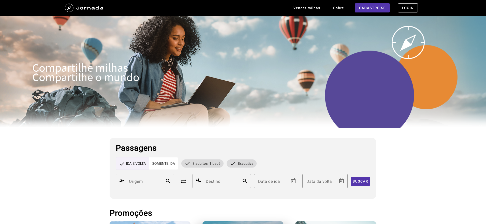

# Jornada Milhas


## 📝 Resumo do Projeto

O Jornada Milhas é uma plataforma voltada à busca de passagens aéreas, permitindo que o usuário pesquise opções de ida e volta, filtre resultados por preço, conexões e companhias aéreas, consulte diferentes alternativas de viagens de acordo com suas necessidades, foi implementado testes E2E (*End-to-end*), com a ferramenta de automação playwright, a fim de aumentar a confiabilidade e qualidade do sistema.



## 🚀 Tecnologias Utilizadas

<div>
   
   
   
   
   
   
</div>

## 📂 Estrutura de Pastas e Arquivos do Projeto

```
├── .angular
├── e2e
│   ├── page-objects
│   │   └── PaginaLogin.ts
│   │   └── PaginaPrincipal.ts
│   ├── example.spec.ts
│   ├── fazerLogin.spec.ts 
│   ├── jornadaBuscarPassagens.spec.ts
│   ├── visitarPaginaInicial.spec.ts
├── jornada-milhas-api
├── node_modules
├── playwright-report
├── src
├── test-results
├── .editorconfig
├── .gitignore
├── angular.json
├── eslint.config.mts
├── package-lock.json
├── package.json
├── playwright.config.ts
├── README.md
├── screenshot.png
├── thumbnail.png
├── tsconfig.app.json
├── tsconfig.json
├── tsconfig.spec.json
```

## 🛠️ Abrir e rodar o projeto Front end e Back end

Para abrir e rodar o projeto no front-end, execute na pasta principal `npm start` e para abrir e rodar a api no back end, entre na pasta `jornada-milhas-api` e execute `npm start` para iniciar a api do projeto.

Depois, acesse <a href="http://localhost:4200/">http://localhost:4200/</a> no seu navegador.

## 🛠️ Abrir e testar o Playwright

Para abrir e testar os arquivos no playwright pelo terminal, execute o comando `npm run e2e` e para abrir e testar os arquivos na interface do playwright, execute o comando `npm run e2e-ui` para iniciar o teste.

## Desenvolvedor
<br>Ronaldo Cesar